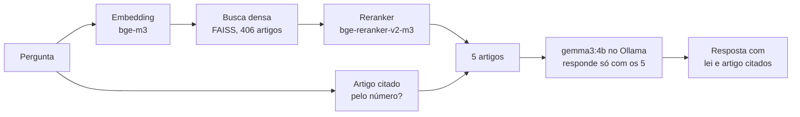

# rag-leis

[](https://github.com/TekhneDev/rag-leis/actions/workflows/ci.yml)
[](pyproject.toml)
[](LICENSE)
[](https://github.com/psf/black)

Sistema de perguntas e respostas (RAG) sobre três leis brasileiras que cita o artigo de onde tirou cada resposta, acompanhado de uma tabela de experimentos que mede o que faz o sistema acertar mais.

**Resultado principal:** no split `dev`, a melhor busca traz o artigo certo entre os 5 primeiros em 94% das perguntas, contra 85% do baseline. A ideia mais óbvia, a busca híbrida, piorou para 56%.

> Este projeto é um estudo e não substitui orientação jurídica.

## Sumário

- [Para que serve](#para-que-serve)
- [Como funciona](#como-funciona)
- [Situação](#situação)
- [Corpus](#corpus)
- [Conjunto ouro](#conjunto-ouro)
- [Como o sistema é avaliado](#como-o-sistema-é-avaliado)
- [Resultados](#resultados)
- [Quatro erros reais, comentados](#quatro-erros-reais-comentados)
- [Limitações](#limitações)
- [Como rodar](#como-rodar)
- [Estrutura do repositório](#estrutura-do-repositório)
- [Reprodutibilidade](#reprodutibilidade)
- [Documentos do projeto](#documentos-do-projeto)
- [Próximos passos](#próximos-passos)
- [Como participar](#como-participar)
- [Licença](#licença)

## Para que serve

Empresas grandes têm muito texto que pouca gente sabe de cor: leis, contratos, normas internas, editais. Um atendente que precisa responder "comprei pelo site e me arrependi, posso devolver?" não sabe o Código de Defesa do Consumidor de cor, e um chatbot comum pode inventar um prazo com toda a confiança.

O rag-leis primeiro procura os artigos certos e só então pede ao modelo que responda, usando apenas o que achou, citando a fonte e dizendo "Não encontrei na base." quando os trechos não respondem. O foco do projeto é a régua: um gabarito escrito antes do sistema existir e métricas separadas para a busca e para a resposta, para saber onde está cada defeito antes de gastar com a solução errada.

Para mostrar o projeto a quem não leu o código, há duas páginas em [`docs/apresentacao/`](docs/apresentacao/): uma história desenhada sobre o uso numa empresa e uma visão técnica com demo.

## Como funciona



| Peça | O que faz | Onde está |
| --- | --- | --- |
| Ingestão | Baixa as leis do Planalto, decodifica Windows-1252 e remove o texto riscado, que é o revogado | `ingest.py` |
| Chunking | Um registro por artigo, com lei, título e capítulo | `chunk.py` |
| Embedding e índice | `BAAI/bge-m3` em CPU e FAISS com busca exata por cosseno; opcionalmente com o nome da lei no texto indexado | `index.py` |
| Busca | Densa, BM25, híbrida (RRF), reranker e artigo citado pelo número, combinados a partir de uma configuração | `retrieve.py` |
| Geração | `gemma3:4b` local, temperatura zero; cita lei e artigo ou responde "Não encontrei na base." | `generate.py` |
| Avaliação | Recall@k, MRR e abstenção por código; correção e fidelidade por LLM juiz; intervalos por bootstrap | `evaluate.py` |
| Experimentos | Roda uma configuração de busca no `dev` e atualiza a tabela | `experimento.py` |
| Interface | App em Streamlit | `app.py` |

Tudo roda localmente, sem chave de API. A pergunta do usuário não sai da máquina.

## Situação

| Fase | Entregável | Situação |
| --- | --- | --- |
| 0. Ambiente | Repositório, lint, testes e CI | Concluída |
| 1. Corpus | `corpus.jsonl`, um registro por artigo | Concluída |
| 2. Conjunto ouro | `gold.jsonl` com 75 perguntas | Redigido; 6 de 75 perguntas validadas por pessoa |
| 3. Baseline | Pipeline de ponta a ponta com busca densa | Concluída |
| 4. Avaliação | `evaluate.py` e números do baseline | Métricas prontas; falta rotular 30 respostas para validar o juiz |
| 5. Experimentos | Tabela de resultados e análise de erros | Busca concluída no `dev`; geração depende do juiz validado |
| 6. Entrega | App, README e demo | App pronto; falta a demo pública e o resultado no `test` |

As métricas de busca são confiáveis, porque são código puro. As de geração ainda não: o juiz passou numa sonda de 4 casos, mas falta compará-lo com rótulos humanos.

## Corpus

Texto publicado no site do Planalto, baixado em 9 de outubro de 2026, sem os trechos revogados:

| Lei | Registros | Último artigo |
| --- | --- | --- |
| Lei 13.709/2018 (LGPD) | 80 | 65 |
| Lei 8.078/1990 (Código de Defesa do Consumidor) | 130 | 119 |
| Lei 14.133/2021 (licitações e contratos administrativos) | 196 | 194 |

Há mais registros do que o número do último artigo porque artigos incluídos depois ganham letra (por exemplo, art. 55-A). Cada linha de `data/processed/corpus.jsonl` tem `id`, `lei`, `artigo`, `titulo`, `capitulo` e `texto`. Uma amostra de 20 artigos sorteados foi conferida à mão contra o original (`results/conferencia_fase1.md`).

Problemas resolvidos na ingestão, com detalhes no [diário](DIARIO.md#fase-1-corpus):

- A Lei 14.133 não tem página "compilado"; a página principal traz 21 trechos riscados, todos removidos.
- O art. 178 da Lei 14.133 transcreve artigos do Código Penal sem aspas. Só conta como artigo novo o que segue a numeração.
- Formatos diferentes de cabeçalho de capítulo entre as leis e um erro de digitação na fonte ("Art. 5 7.").

## Conjunto ouro

`data/gold/gold.jsonl` tem 75 perguntas, cada uma com a resposta esperada e os artigos que a contêm. Foi escrito antes de existir qualquer busca, pela mesma lógica de separar o conjunto de teste antes de treinar um modelo.

| Tipo | Perguntas | Exemplo | O que testa |
| --- | --- | --- | --- |
| `direta` | 27 | Qual é o objetivo da LGPD? | O caso básico |
| `leiga` | 19 | Cancelei minha conta num aplicativo. A empresa pode continuar guardando meus dados? | Busca por significado, sem as palavras da lei |
| `varios_artigos` | 10 | Quem é o encarregado pelo tratamento de dados e quais são as suas atividades? | Recuperar mais de um trecho |
| `termo_exato` | 10 | O que diz o art. 75 da Lei 14.133? | Número de artigo e palavra-chave |
| `fora_do_escopo` | 9 | Qual o prazo para entrar com ação trabalhista? | Se o sistema admite que não sabe |

- **Dois campos de artigos.** `artigos_esperados` são os que precisam vir para a resposta estar completa, e é sobre eles que o recall é medido. `artigos_aceitos` são correlatos que também respondem em parte (12 perguntas têm algum); recuperá-los não conta como erro.
- **Dev e test.** 39 perguntas em `dev` e 36 em `test`, metade de cada tipo em cada parte. O sistema é ajustado olhando só o `dev`; o `test` será usado uma única vez, no fim.
- **Validação humana.** As perguntas foram redigidas por um LLM a partir do corpus e revisadas por outro passe de LLM. A validação humana, uma a uma, está em `results/validacao_gold.md`: 6 validadas até agora, com correções em q005, q009 e q011.

## Como o sistema é avaliado

Um RAG erra em dois lugares: a busca não trouxe o trecho certo, ou trouxe e o modelo respondeu mal. Cada falha tem conserto próprio, então cada uma tem métrica própria.

| Métrica | Metade | Pergunta que responde | Como é calculada |
| --- | --- | --- | --- |
| Recall@k | Busca | O artigo esperado apareceu entre os k trazidos? | Código puro, comparando ids |
| MRR | Busca | Quão perto do topo ele apareceu? | Média de 1 dividido pela posição do primeiro acerto |
| Acerto@5 | Busca | Veio algum artigo esperado ou aceito? | Código puro |
| Abstenção correta | Geração | Nas perguntas fora do escopo, disse que não sabe? | Código puro, pela frase fixa |
| Correção | Geração | A resposta bate com a resposta esperada? | LLM juiz (`gemma3:12b`) |
| Fidelidade | Geração | Cada afirmação está apoiada nos trechos? | LLM juiz (`gemma3:12b`) |

Todas as médias vêm com intervalo de 95% por bootstrap, e os resultados são sempre mostrados por tipo de pergunta, porque a média geral esconde onde o sistema sofre.

**O juiz também é testado.** O primeiro juiz foi o `gemma3:4b`, o mesmo modelo que gera as respostas. Numa sonda com três respostas falsas de propósito, ele aprovou duas: uma com prazo inventado e uma que contradiz o artigo. Seus números foram descartados. O `gemma3:12b` acertou os quatro casos da mesma sonda (`results/baseline/sonda_juiz_*.json`). Quatro casos são indício, não validação: a fase 4 só fecha quando o juiz concordar com rótulos humanos em pelo menos 80% de 30 respostas.

## Resultados

Tudo abaixo é do split `dev`: 39 perguntas, 34 com artigo esperado. Com 5 a 14 perguntas por tipo, os intervalos são largos e diferenças pequenas são ruído. O `test` não foi medido.

### Baseline

| Tipo | Perguntas | Recall@1 | Recall@5 | MRR | Resposta correta |
| --- | --- | --- | --- | --- | --- |
| Geral | 34 | 0,63 | 0,85 [0,74 a 0,96] | 0,76 | 0,74 [0,59 a 0,88] |
| Direta | 14 | 0,93 | 1,00 | 0,95 | 1,00 |
| Linguagem leiga | 10 | 0,40 | 0,80 [0,50 a 1,00] | 0,53 | 0,30 |
| Vários artigos | 5 | 0,50 | 0,80 [0,60 a 1,00] | 1,00 | 1,00 |
| Termo exato | 5 | 0,40 | 0,60 [0,20 a 1,00] | 0,45 | 0,60 |

- **Abstenção correta:** nas 5 perguntas fora do escopo, o sistema respondeu "Não encontrei na base." em todas.
- **Abstenção indevida:** em 8 das 34 perguntas com resposta no corpus o sistema também disse que não encontrou, 6 delas leigas. Na maioria, o artigo certo estava entre os trechos.
- **Fidelidade** segundo o juiz: 1,00 em 26 respostas. Correção e fidelidade ainda aguardam a validação humana do juiz.

### Experimentos de busca

Cada linha muda uma peça em relação ao baseline e sai de um comando (`python -m rag_leis.experimento experiments/<nome>.json`). Tabela completa em `results/experimentos/tabela.md`.

| Busca | Recall@5 | IC 95% | MRR | Termo exato (R@5 / MRR) | Leiga (R@5 / MRR) |
| --- | --- | --- | --- | --- | --- |
| Densa (baseline) | 0,85 | 0,73 a 0,96 | 0,76 | 0,60 / 0,45 | 0,80 / 0,53 |
| BM25 | 0,50 | 0,32 a 0,68 | 0,35 | 0,60 / 0,21 | 0,00 / 0,00 |
| Híbrida, RRF com pesos iguais | 0,56 | 0,38 a 0,73 | 0,45 | 0,40 / 0,24 | 0,20 / 0,12 |
| Híbrida, BM25 com peso 0,25 | 0,63 | 0,47 a 0,79 | 0,54 | 0,40 / 0,25 | 0,40 / 0,22 |
| Densa + artigo citado primeiro | 0,88 | 0,77 a 0,97 | 0,81 | 0,80 / 0,80 | 0,80 / 0,53 |
| Densa com cabeçalho da lei | 0,90 | 0,79 a 0,98 | 0,79 | 0,80 / 0,50 | 0,80 / 0,60 |
| Densa com cabeçalho + artigo citado | 0,90 | 0,79 a 0,98 | 0,83 | 0,80 / 0,80 | 0,80 / 0,60 |
| Densa + reranker | 0,90 | 0,79 a 0,97 | 0,80 | 0,60 / 0,40 | 0,90 / 0,73 |
| Densa + reranker + artigo citado | 0,93 | 0,84 a 1,00 | 0,86 | 0,80 / 0,80 | 0,90 / 0,73 |
| **Cabeçalho + reranker + artigo citado** | **0,94** | 0,85 a 1,00 | **0,89** | 0,80 / 0,80 | 0,90 / 0,78 |

O que a tabela mostra:

1. **A híbrida piorou.** A hipótese era ganhar no termo exato sem perder nas leigas; perdeu nas duas. O texto indexado não trazia o nome da lei, o próprio art. 75 é longo e o BM25 o deixou em 130º lugar, e o RRF premia artigos medianos nas duas listas em vez do 1º lugar de uma delas. Nem dando ao BM25 um quarto do peso ela alcança a densa.
2. **Trazer primeiro o artigo citado** resolveu o termo exato: MRR de 0,45 para 0,80. Uma expressão regular simples bateu a busca por palavra-chave.
3. **O nome da lei no texto indexado** ("Lei 8.078/1990 (Código de Defesa do Consumidor, CDC), art. 49 · capítulo") levou a densa de 0,85 para 0,90, sem custo nenhum na hora da pergunta.
4. **O reranker** ajudou mais nas leigas (MRR de 0,53 para 0,73), ao custo de uns 30 segundos a mais por pergunta em CPU.
5. **As três peças se somam.** Cabeçalho, reranker e artigo citado juntos dão a melhor linha: recall@5 de 0,94 e MRR de 0,89. É a busca "Completa" do app; a "Rápida" é a densa com cabeçalho e artigo citado, sem o reranker.
6. **A melhor linha foi escolhida olhando o `dev`**, então seu número é otimista. O valor para reportar sairá do `test`, rodado uma única vez junto com o baseline.

## Quatro erros reais, comentados

**q040, falha de busca que o reranker consertou.** "Meu nome está negativado por uma dívida antiga. Por quanto tempo isso pode ficar registrado?" A resposta está no art. 43 do CDC, que fala em "bancos de dados e cadastros de consumidores", sem a palavra "negativado". Nenhuma busca por embedding ou por palavra trouxe o artigo; o modelo, sem o trecho, disse que não encontrou. Com o reranker, que lê pergunta e artigo juntos, o art. 43 passou a vir em 1º lugar.

**q028, abstenção indevida, e um caso em que o reranker piorou.** "Cancelei minha conta num aplicativo. A empresa pode continuar guardando meus dados?" A busca densa trouxe o art. 16 da LGPD em 1º lugar, e mesmo assim o modelo respondeu "Não encontrei na base.": a falha foi da geração, não da busca. É o padrão das 8 abstenções indevidas, e por isso o próximo experimento é no prompt. Com o reranker, o art. 16 saiu do top 5: a média melhorou, mas esta pergunta piorou.

**q065, número de artigo que a busca por significado não entende.** "Qual é o conteúdo do art. 37 da Lei 13.709/2018?" Para o embedding, "art. 37" quase não carrega significado, e o artigo não veio entre os 5. A regra que detecta "art. N" e o nome da lei passou a trazê-lo em 1º lugar.

**q063, a única pergunta em que só o BM25 acerta.** "O que o Código de Defesa do Consumidor diz sobre a inversão do ônus da prova?" O art. 6º do CDC, que contém a expressão exata, veio em 2º no BM25 e em nenhuma busca densa, com ou sem reranker. A expressão é termo técnico e o art. 6º é uma lista longa de direitos, onde ela é só um inciso. É o caso que justificaria uma híbrida bem calibrada, que esta rodada não encontrou.

## Limitações

- **Amostra pequena.** São 34 perguntas com artigo esperado no `dev` e 5 de termo exato; uma pergunta muda o recall desse tipo em 0,20.
- **Gabarito em validação.** 69 das 75 perguntas ainda não foram lidas por uma pessoa, e foram escritas por um LLM. Se uma pergunta do `dev` mudar, os experimentos são rodados de novo com o mesmo comando.
- **Juiz não validado.** Correção e fidelidade dependem de um juiz LLM que ainda não foi comparado com rótulos humanos.
- **Ajuste no `dev`.** As melhores configurações foram escolhidas olhando o `dev`; seus números são otimistas até a rodada única no `test`.
- **Corpus fixo e pequeno.** Três leis baixadas em 9 de outubro de 2026. Alterações posteriores e regulamentações, como os decretos que atualizam os valores de dispensa de licitação, não estão no corpus.
- **Lento em CPU.** A resposta leva de 1 a 2 minutos com o `gemma3:4b`, e o reranker soma uns 30 segundos.
- **Artigos longos são cortados.** O reranker lê só os primeiros 512 tokens de cada artigo, e o prompt corta artigos acima de 6.000 caracteres.

## Como rodar

### Instalação

Requer Python 3.10 ou mais recente e cerca de 15 GB livres para os modelos.

```bash
git clone https://github.com/TekhneDev/rag-leis.git
cd rag-leis
python3 -m venv .venv
source .venv/bin/activate      # Windows: .venv\Scripts\activate
pip install torch --index-url https://download.pytorch.org/whl/cpu
pip install -e ".[dev,app]"
```

A linha do PyTorch instala a versão só para CPU, bem menor. Quem tem placa de vídeo com bastante memória pode pular essa linha.

O LLM roda no [Ollama](https://ollama.com/download), local e gratuito:

```bash
ollama serve                 # em outro terminal; deixe aberto
ollama pull gemma3:4b        # gera as respostas, 3,4 GB
ollama pull gemma3:12b       # juiz da avaliação, 8 GB (opcional)
```

### Corpus e índices

O corpus já está no repositório. Os índices são gerados uma vez; o primeiro comando baixa o modelo de embedding (cerca de 2 GB), e cada um leva alguns minutos em CPU:

```bash
python -m rag_leis.chunk              # só se quiser refazer o corpus a partir do Planalto
python -m rag_leis.index              # índice do baseline, só o texto do artigo
python -m rag_leis.index --cabecalho  # índice com o nome da lei, usado pelo app
```

### App

```bash
streamlit run app.py
```

Abra http://localhost:8501. O app tem campo de pergunta, exemplos, a resposta e os artigos usados ao lado, cada um com o texto completo e o link para a lei no Planalto. Na barra lateral dá para escolher entre a busca rápida (densa com cabeçalho e artigo citado) e a completa (com reranker), e desligar a geração para ver só os artigos, sem o Ollama.

### Linha de comando

```bash
python -m rag_leis.responder "O que é cláusula abusiva em contrato de consumo?"
```

Mostra os 5 artigos recuperados pela busca do baseline, com a similaridade, e a resposta com a lei e o artigo citados.

### Reproduzir o baseline, a avaliação e os experimentos

```bash
python -m rag_leis.baseline                    # 75 perguntas; pode ser interrompido e retomado
python -m rag_leis.evaluate                    # métricas de busca e abstenção no dev
export RAG_LEIS_JUIZ=gemma3:12b
python -m rag_leis.evaluate --juiz             # inclui correção e fidelidade
python -m rag_leis.evaluate --sondar           # testa o juiz com respostas falsas
python -m rag_leis.evaluate --concordancia     # compara o juiz com results/baseline/rotulos.csv
python -m rag_leis.experimento experiments/*.json   # todos os experimentos de busca e a tabela
```

Os experimentos com reranker baixam mais 2 GB e levam uns 20 minutos cada em CPU. O `experimento.py` se recusa a rodar no `test`.

### Variáveis de ambiente

| Variável | Padrão | Para quê |
| --- | --- | --- |
| `RAG_LEIS_LLM` | `gemma3:4b` | Modelo do Ollama que gera as respostas |
| `RAG_LEIS_JUIZ` | o mesmo do LLM | Modelo do Ollama usado como juiz; use um diferente do gerador |
| `OLLAMA_URL` | `http://localhost:11434` | Endereço do servidor do Ollama |

O projeto não usa chave de API. Se um dia usar, ela fica num arquivo `.env`, que está no `.gitignore`.

### Testes

```bash
ruff check .
black --check .
pytest
```

O GitHub Actions roda os três a cada push.

## Estrutura do repositório

```text
rag-leis/
  app.py                    # interface web (Streamlit)
  data/
    raw/                    # HTML original das leis (fora do Git)
    processed/corpus.jsonl  # 406 artigos
    gold/gold.jsonl         # 75 perguntas com resposta e artigos esperados
    index/                  # vetores dos artigos (fora do Git, gerados por comando)
  src/rag_leis/
    ingest.py               # baixar e limpar
    chunk.py                # cortar por artigo
    index.py                # embeddings, índices e texto com cabeçalho
    retrieve.py             # densa, BM25, RRF, reranker, artigo citado e a pipeline
    generate.py             # prompt e chamada ao Ollama
    responder.py            # uma pergunta de ponta a ponta
    baseline.py             # conjunto ouro inteiro pelo baseline
    evaluate.py             # métricas, juiz, sonda e concordância
    experimento.py          # experimentos de busca a partir de configuração
  experiments/              # uma configuração JSON por experimento
  results/
    baseline/               # saídas, julgamentos, sondas e rotulagem
    experimentos/           # métricas de cada experimento e tabela.md
    validacao_gold.md       # validação humana das perguntas
    conferencia_fase1.md    # conferência manual do corpus
  docs/
    apresentacao/           # as duas páginas de apresentação
    guia-validacao-gold-dev.pdf
  tests/
  .github/workflows/ci.yml
  pyproject.toml
```

## Reprodutibilidade

- **Temperatura zero e semente fixa** em toda chamada ao LLM, e todas as saídas salvas em disco (`results/`).
- **Versões fixadas:** Python 3.14.4, torch 2.14.1 (CPU), sentence-transformers 6.1.0, faiss-cpu 1.15.1, rank-bm25 0.2.2, Ollama 0.40.2. A lista completa está no [diário](DIARIO.md#máquina-e-versões).
- **Cada linha da tabela de experimentos** é um arquivo em `experiments/` e um comando. A configuração usada fica gravada junto com as métricas e os ids recuperados de cada pergunta.
- **Máquina usada:** Linux no WSL2, 12 núcleos, 15 GB de RAM, tudo em CPU.

## Documentos do projeto

| Documento | O que tem |
| --- | --- |
| [Roadmap](Roadmap%20RAG%20jur%C3%ADdico%20com%20avalia%C3%A7%C3%A3o.md) | O plano original: conceitos, fases, métricas e armadilhas |
| [Diário](DIARIO.md) | O que foi feito em cada fase, passo a passo, com os problemas e os erros cometidos |
| [Plano](PLANO.md) | Próximas etapas ligadas ao que o mercado de trabalho pede, e como contar o projeto em entrevista |
| [Apresentação](docs/apresentacao/) | História desenhada e visão técnica, em HTML |
| [Validação do gabarito](results/validacao_gold.md) | As 75 perguntas para conferência humana |
| [Rotulagem do juiz](results/baseline/rotular.md) | As 30 respostas para rotular |

## Próximos passos

1. Validar as 75 perguntas do gabarito e rotular as 30 respostas do juiz. Os dois dependem de leitura humana.
2. Atacar as 8 abstenções indevidas com um prompt menos rígido, medido pelo juiz validado.
3. Fazer a análise de erros da melhor configuração, classificando cada falha em busca, geração, gabarito ou pergunta ambígua.
4. Rodar o baseline e a melhor configuração no `test`, uma única vez, e reportar os dois números.
5. Publicar a demo e escrever um texto curto sobre o achado que contrariou a hipótese.

## Como participar

Erros no gabarito, respostas que contradizem a lei e bugs são bem-vindos como issues, cada um com seu modelo. Mudanças de código só depois de combinadas numa issue.

| Documento | Para quê |
| --- | --- |
| [Como contribuir](CONTRIBUTING.md) | O que é mais útil, as regras que protegem os resultados e o estilo do projeto |
| [Código de conduta](CODE_OF_CONDUCT.md) | Como as pessoas se tratam aqui |
| [Segurança](SECURITY.md) | Como relatar uma vulnerabilidade em privado e como rodar o app com segurança |
| [Citação](CITATION.cff) | Como citar o projeto como referência |

## Licença

Copyright (c) 2026 Carla Braga. **Todos os direitos reservados.** Você pode ver e ler este repositório no GitHub, inclusive para avaliar o trabalho. Copiar, modificar, distribuir ou usar o código, o conjunto ouro, os resultados, os documentos ou as páginas, no todo ou em parte, exige autorização prévia e por escrito. O uso não autorizado sujeita o responsável às medidas previstas na Lei 9.610/1998 e no art. 184 do Código Penal. O texto das leis do corpus não é coberto, porque não tem proteção autoral. Os termos completos estão em [`LICENSE`](LICENSE).

---

Projeto de Carla Braga. O código e os arquivos foram escritos com o Claude Code; o corpus foi conferido e as decisões de projeto foram tomadas por Carla.
