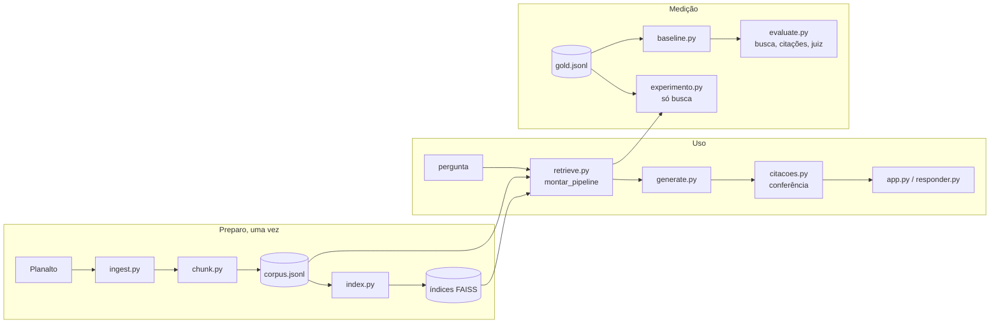

# Arquitetura

Como o rag-leis é organizado, por que cada decisão foi tomada e o que vem depois. O README explica o que o projeto faz e como rodar; este documento é para quem vai mexer no código.

## Visão geral

O sistema tem dois caminhos que compartilham as mesmas peças: o caminho de **uso** (app e linha de comando), que responde uma pergunta, e o caminho de **medição** (baseline, avaliação e experimentos), que mede o sistema contra o conjunto ouro.



## Módulos

| Módulo | Responsabilidade | Depende de |
| --- | --- | --- |
| `dados.py` | Caminhos (a partir da raiz do repositório) e leitura e escrita de JSONL | nada |
| `ingest.py` | Baixar o HTML do Planalto e limpar o texto revogado | `dados` |
| `chunk.py` | Cortar o texto em artigos, com título e capítulo | `ingest`, `dados` |
| `index.py` | Texto indexado (com ou sem cabeçalho), embeddings e índice FAISS | `dados` |
| `citacoes.py` | Ler referências a artigos: as da pergunta e as da resposta | nada |
| `retrieve.py` | Buscas (densa, BM25, híbrida), reranker, artigo citado, a pipeline e os `MODOS` | `index`, `citacoes`, `dados` |
| `generate.py` | Prompt e chamada ao Ollama, inteira ou aos pedaços | nada |
| `responder.py` | Uma pergunta de ponta a ponta na linha de comando | `retrieve`, `generate`, `citacoes` |
| `baseline.py` | Gabarito inteiro pela busca do baseline, retomável | `retrieve`, `generate` |
| `evaluate.py` | Métricas de busca, de citação e do juiz LLM; sonda e concordância | `generate`, `citacoes`, `dados` |
| `experimento.py` | Roda uma configuração de busca no `dev` e monta a tabela | `retrieve`, `evaluate` |
| `app.py` | Interface Streamlit | `retrieve`, `generate`, `citacoes` |

As dependências só descem: nenhum módulo de baixo importa um de cima, e `citacoes.py` e `generate.py` não carregam modelo nenhum, o que deixa os testes rápidos.

## A pipeline de busca

Uma busca é uma função `(pergunta, n) -> ids`. As peças são decoradores que recebem uma busca e devolvem outra:

```text
montar_busca(config)            densa | bm25 | hibrida (RRF)
  -> com_reranker(busca)        se config["reranker"]
  -> com_referencia(busca)      se config["referencia"]
  -> pergunta -> ids[:k]        montar_pipeline
```

Essa forma tem três consequências:

1. **Um experimento é um arquivo JSON.** Ligar ou desligar uma peça não exige código novo, e a regra de mudar uma peça por vez fica visível no nome do arquivo.
2. **O app usa exatamente o que foi medido.** Os dois modos do app (`MODOS` em `retrieve.py`) são configurações com experimento gravado, e um teste confere isso.
3. **A ordem importa e é fixa.** A referência vem por último para que o artigo citado pelo número não possa ser rebaixado pelo reranker.

Os buscadores e os modelos ficam em cache por processo (`lru_cache`). O app com dois modos carrega o bge-m3 uma vez, e uma rodada de vários experimentos não recarrega modelo a cada configuração.

## Decisões

Cada decisão com o motivo e o que custaria mudar.

| Decisão | Motivo | Alternativa descartada |
| --- | --- | --- |
| Um chunk por artigo | O artigo é a unidade que a pergunta cita e que a resposta precisa citar | Janelas de tamanho fixo cortam incisos no meio e misturam artigos |
| FAISS `IndexFlatIP`, busca exata | 406 vetores; um índice aproximado só traria erro | HNSW ou IVF, úteis a partir de centenas de milhares de vetores |
| Tudo local (Ollama, CPU) | Custo zero, sem chave de API e sem enviar pergunta para fora | API paga, que deixaria a geração mais rápida e melhor |
| Temperatura 0 e semente fixa | A mesma entrada dá a mesma saída, o que torna as métricas reproduzíveis | Amostragem, que exigiria várias rodadas por pergunta |
| Configuração em dicionário com `PADRAO` | Lê direto do JSON e grava junto do resultado | Dataclass, mais rígida mas com conversão extra; a validação de chaves em `ler_config` cobre o erro mais comum |
| Conferência de citação por código | Determinística, grátis e roda em cada resposta do app | Só o juiz LLM, que é lento e precisa ser validado |
| Split `test` intocado | O número final precisa vir de perguntas que não guiaram nenhuma escolha | Ajustar no conjunto inteiro, o que infla o resultado |

## Garantias e onde estão

| Garantia | Onde é conferida |
| --- | --- |
| Corpus sem buraco na numeração, sem rodapé e sem texto revogado repetido | `tests/test_corpus.py` |
| Gabarito aponta só para artigos que existem | `tests/test_gold.py` |
| A busca BM25 reproduz o resultado gravado no `dev` | `tests/test_regressao.py`, no CI |
| Os modos do app são configurações medidas | `tests/test_experimento.py` |
| Arquivo de experimento sem chave desconhecida | `ler_config` e `tests/test_experimento.py` |
| Experimento não roda no `test` | `experimento.main` |
| Índice e corpus batem | `Buscador.__init__` |
| Respostas e julgamentos gravados a cada pergunta, retomáveis | `baseline.rodar`, `evaluate.julgar` |
| Mesmo lint no CI e na máquina | versões de `ruff` e `black` fixadas no `pyproject.toml` |
| Ambiente dos resultados recuperável | `requirements.lock` |

## Conferência de citações

`citacoes_da_resposta` lê na resposta os pares lei e artigo nas duas ordens em que o modelo escreve, "(Lei 8.078/1990, art. 49)" e "art. 51, inciso VI, da Lei 8.078/1990", incluindo listas ("artigos 75 e 85"). Um artigo citado que não estava entre os recuperados veio da memória do modelo, não da base.

Ficam de fora, de propósito:

- **"art. 75" sem lei ao lado**, porque não dá para saber de qual lei é;
- **leis fora do corpus**, que quase sempre são o próprio artigo recuperado citando outra lei.

No `evaluate.py` isso vira duas métricas, nas respostas em que o sistema não se absteve:

- `cita_artigo`: a resposta cita lei e artigo.
- `citacoes_nos_trechos`: todos os artigos citados estavam entre os recuperados.

No app vira um aviso logo abaixo da resposta.

## Próximos passos

Em ordem de valor para o projeto. O detalhe de cada um, com comandos e critério de pronto, está no [plano](../PLANO.md#próximos-passos).

1. **Medir a geração com a busca completa no `dev`.** Hoje só a busca foi melhorada e medida. Falta rodar a geração com o modo `completa`, depois o juiz e as métricas de citação, e comparar abstenção e correção com o baseline. A hipótese é que a abstenção indevida das perguntas leigas cai, porque o artigo certo passa a vir no topo.
2. **Validar o juiz com os 30 rótulos humanos.** Sem isso, `fiel` e `correta` são números de um modelo não validado. É a tarefa que só a Carla pode fazer.
3. **Expor o pipeline como API (FastAPI) e empacotar em Docker.** O app atual é uma demo. Uma API com `/perguntar`, esquema de resposta tipado e um `docker compose` com o Ollama mostra o caminho para produção.
4. **Registro de uso.** Gravar, para cada pergunta do app, o modo, os ids, a latência de busca e de geração e o resultado da conferência, sem guardar a pergunta em texto, por causa da LGPD.
5. **Rodar o `test` uma única vez**, com o baseline e a melhor configuração, e reportar os dois números com intervalo de confiança.
